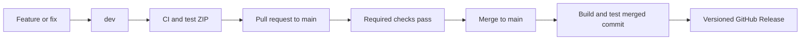

# Development and releases

Two long-lived branches are enough for this importer:

| Ref | Purpose | GitHub does |
|---|---|---|
| `dev` | Ongoing development; new work normally targets this branch | Verify, build the portable ZIP and retain it as a test artifact |
| `main` | Tested release line; receives PRs from `dev` | Verify the merged commit, build/test its ZIP and automatically publish a new version |
| `v0.1.0`, etc. | Exact published source revision | Identifies a fixed release; never move a published tag or replace its assets |

The main line is the stable distribution channel. The converter itself remains alpha until its
documented fidelity gates are passed; branch names do not make untested source features supported.

## Normal work

1. Branch from `dev`, implement the change and open a PR back to `dev` (small solo changes can
   go directly to `dev`). CI runs format, Clippy, Rust tests and a relocated portable ZIP
   test. Actions artifacts are for developers; they are not the app's automatic download channel.
2. When ready to promote, update the version in `Cargo.toml` and `Cargo.lock`, update
   `RELEASE_NOTES.md`, and run the opt-in sample conversion (`ONENOTE_SAMPLES`).
3. Open a PR from `dev` to `main`. Required CI must pass on the proposed merge. Merge this PR
   with a merge commit so the two long-lived branches retain their shared history.
4. The push to `main` builds again from the actual merged commit. If verification, packaging
   and smoke tests pass, GitHub creates the version tag and Release, with ZIP, descriptor JSON
   and `SHA256SUMS`. No local release build or manual asset upload is needed.
5. Merge `main` back into `dev` before continuing the next release. Never force-reset either
   shared branch. A hotfix promoted through `main` must also return to `dev`.

Merging without a version bump still builds and tests, but does not replace an existing release.
A failed workflow publishes nothing new; the previous release remains available. Fix on `dev`
and promote again. A prerelease suffix such as `0.2.0-rc.1` produces a GitHub prerelease.
Versions without a suffix produce normal releases. Version numbers describe release identity;
the README still describes the current alpha limitations.

## Branch rules

Protect `main`: require a pull request, require the `verify-and-package` check on an up-to-date
branch, resolve review conversations, and block force pushes/deletion. Required reviewer count
can remain zero for a solo maintainer; do not require the owner to approve their own PR.
Keep `main` as the default branch so visitors see released documentation. Feature PRs should
explicitly target `dev`. Enable merge commits for `dev` → `main` promotions.

The workflows do not run privileged release work on pull requests. Build jobs have read-only
repository permissions; only the successful `main` publishing job has content-write permission.
Third-party Actions are pinned to commits. Release jobs serialize so two promotions cannot race
to publish a version. Normal users download fixed Release assets without a GitHub login.

## Goodtype download policy

The app can bootstrap from a tested package hash pinned in its source. Explicit update checks
fetch `importer-update.json` from the latest stable release and verify its detached Ed25519
signature (`importer-update.json.sig`) with the app-pinned public key before trusting the package
URL/hash. Reject incompatible protocol/schema/target, dirty builds, prereleases and downgrades.
Do not execute branch source, unsigned latest binaries or development artifacts.

`release-public-key.pem` (created once, before the first release that should be updatable from
Goodtype) is the public verification key. Its private counterpart is the repository
Actions secret `IMPORTER_SIGNING_KEY`; it is available only to the successful protected-main
publisher job. `scripts/sign_release.py` signs the exact descriptor bytes using OpenSSL and
verifies against the checked-in public key before publication. No private key enters an artifact.
Rotating this key requires a coordinated Goodtype update; do not replace it as routine maintenance.
An installed compatible importer continues working offline; a bad new release can be replaced
by selecting the prior known-good version, without changing any imported notebook. A published
release mistake is fixed with a new version, not by silently changing old bytes.

## What larger projects do

- [VS Code's development process](https://github.com/microsoft/vscode/wiki/Development-Process)
  uses an Insiders prerelease/testing period before a stable channel release. The relevant
  practice is separate developer testing and user distribution.
- [Rust's release process](https://forge.rust-lang.org/release/process.html) promotes branches
  through beta/stable with automated release infrastructure. The relevant practice is deliberate
  promotion of tested revisions and clear channel identity.
- [Godot's release policy](https://docs.godotengine.org/en/stable/about/release_policy.html)
  maintains version-specific stable branches for patch releases. This becomes useful if we need
  to maintain multiple importer versions in parallel; it is unnecessary for the first release.

These projects do not all use our `dev`/`main` branch names. This is a smaller adaptation of
their testing, promotion and versioned-release practices, not a copy of their entire process.
